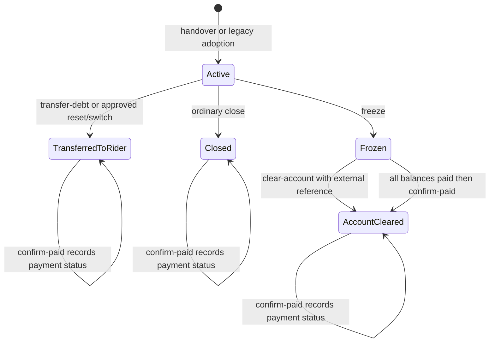

# Jahez: complete API reference

Verified against the current checkout on **11 October 2026**, including the debt transfer, freeze, account clearance, and paid confirmation update. This is a backend contract and integration handoff. The hosted database migration was applied on 11 October 2026; see [deployment verification](jahez-debt-migration-deployment-20261011.md). Frontend implementation and updated API deployment are separate from that database operation.

Companion files:

- [Frontend changelog and implementation specification](jahez-frontend-changelog-and-spec.md)
- [Complete TypeScript request and response contracts](jahez-api-contracts.ts)
- [Postman collection](jahez.postman_collection.json)
- [Controller-derived endpoint and permission inventory](jahez-endpoint-inventory.json)
- [Database upgrade script](../database/scripts/jahez-debt-freeze-and-clearance.sql)

## 1. Contract conventions

| Topic | Exact contract / frontend handling |
|---|---|
| Base path | `/api/jahez` |
| Authentication | `Authorization: Bearer <accessToken>` on all endpoints |
| Success | All 36 Jahez endpoints return HTTP 200 on success; original file download returns binary XLSX rather than JSON |
| JSON | camelCase field names; Jahez enums are numeric |
| Request body | JSON except `POST /imports`, which requires `multipart/form-data` |
| POST header | `Idempotency-Key` is required on every Jahez POST; nonblank and at most 150 characters |
| Key lifecycle | Generate a key for one logical submission. Keep that key, the actor, and the exact payload across timeout/retry. Generate a new key after editing the request or beginning a different operation |
| Key scope | Receipts are scoped to actor, operation, and key. Reusing the key for a different payload in that scope returns 409. Current permission is checked even on replay |
| Replay response | The stored operation response can describe the state at the original execution. Refetch GET resources to show the current state after replay |
| Dates | `DateOnly` = `YYYY-MM-DD`; timestamps = ISO 8601 with an offset. The backend stores instants in UTC |
| Business timezone | Riyadh, UTC+03:00. Use this timezone for business dates, daily commission, reminders, and cashbox cutoff |
| Currency | SAR. Collection inputs must have at most 2 decimal places. Imports, opening balances, adjustments, and earnings allow up to 6 decimal places |
| Rounding | Balance/commission money uses 2 decimals, midpoint away from zero. Do not replace authoritative backend calculations with JavaScript floating-point arithmetic |
| Reasons | Financial/state commands require nonblank `reason`, maximum 2,000 characters. Replacement imports use `correctionReason` instead |
| Pagination | `page=1`, `pageSize=50` by default; page 1..100,000; pageSize 1..100 |
| Page shape | `{ "items": [], "page": 1, "pageSize": 50 }`. No `totalCount`, `totalPages`, or `hasNext` field |
| IDs | UUIDs are internal IDs. `externalAccountId` / spreadsheet `Driver ID` is an external text identifier; do not use it in a `{id}` route |
| Authorization | Jahez capability checks use the `ClientPlatform` scope of the platform with code `JAHEZ`; hiding a frontend button does not replace server checks |
| Financial evidence | Changes are recorded as ledger/settlement/history entries; do not expose deletion as a way to erase debt |

### Identity map

| Name | Meaning | Used by |
|---|---|---|
| `accountId` | Platform account UUID | New handover, account filters, shared account detail |
| `handoverId` | One rider's financial usage period | Balance, ledger, payments, freeze, transfer, clearance, confirmation |
| Handover response `id` | Same identifier as `handoverId` | Store after `POST /handovers` |
| `assignmentId` | Underlying rider/client assignment UUID | Legacy adoption and operational history |
| `riderProfileId` / query `riderId` | Actual rider liable for that usage period | Debts, handovers, summaries, dispatches |
| `ownerRiderProfileId` | Registered account owner's rider profile | Display and account creation; may differ from actual rider |
| Approval `{id}` | Approval request UUID | Decision, cancellation, approval details |
| Import `{id}` | Import batch UUID | Preview and commit |
| Import-file `{id}` | `files[].id`, not batchId | Original XLSX download |
| Cashbox handover `{id}` | Accountant handoff UUID | Cashbox confirmation and final decision |

## 2. All 36 endpoints

Paths below are relative to `/api/jahez`. `Page<T>` means `JahezPage<T>`. Response aliases are fully defined in section 12 and the TypeScript companion. Endpoints marked NEW were added for the debt update.

| # | Method | Path | Input | HTTP 200 response | Required permission |
|---|---|---|---|---|---|
| E01 | POST | `/handovers` | `JahezHandoverRequest` | `Handover` | `jahez.handovers.create` |
| E02 | POST | `/legacy-adoptions` | `JahezLegacyAdoptionRequest` | `Handover` | `jahez.adjustments.create` |
| E03 | POST | `/handovers/{id}/close` | `JahezCloseRequest` | `Handover` | `jahez.handovers.delete` |
| E04 NEW | POST | `/handovers/{id}/freeze` | `JahezDebtFreezeRequest` | `Balance` | `jahez.resets.approve` |
| E05 NEW | POST | `/handovers/{id}/transfer-debt` | `JahezDebtTransferRequest` | `Balance` | `jahez.resets.approve` |
| E06 NEW | POST | `/handovers/{id}/clear-account` | `JahezAccountClearanceRequest` | `Balance` | `jahez.resets.approve` |
| E07 NEW | POST | `/handovers/{id}/confirm-paid` | `JahezDebtPaidRequest` | `Balance` | `jahez.collections.create` |
| E08 NEW | GET | `/riders/{riderId}/debt-summary` | Rider UUID | `RiderDebtSummary` | `jahez.read` |
| E09 | GET | `/handovers` | `accountId?`, `riderId?`, page | `Page<Handover>` | `jahez.read` |
| E10 | GET | `/handovers/{id}/balance` | `through` business date | `Balance` | `jahez.read` |
| E11 | GET | `/debts` | `riderId?`, `overdueOnly=false`, page | `Page<Balance>` | `jahez.read` |
| E12 | GET | `/ledger` | `riderId?`, `handoverId?`, page | `Page<LedgerEntry>` | `jahez.read` |
| E13 | GET | `/handovers/{id}/fee` | Handover UUID | `AccountFee` | `jahez.read` |
| E14 | GET | `/handovers/{id}/settlements` | Handover UUID, page | `Page<Settlement>` | `jahez.read` |
| E15 | GET | `/handovers/{id}/earnings` | Handover UUID, page | `Page<EarningsStatement>` | `jahez.read` |
| E16 | GET | `/handovers/{id}/commission-policies` | Handover UUID, page | `Page<CommissionPolicy>` | `jahez.read` |
| E17 | POST | `/requests` | `JahezApprovalCreateRequest` | `ApprovalDetails` | `jahez.requests.create` |
| E18 | POST | `/requests/{id}/decision` | `JahezDecisionRequest` | `ApprovalDetails` | `jahez.read` + the kind-specific approval permission |
| E19 | POST | `/requests/{id}/cancel` | `JahezCancelRequest` | `ApprovalDetails` | `jahez.requests.create`; must be the requester |
| E20 | GET | `/requests` | `status?`, page | `Page<ApprovalRequest>` | `jahez.read` |
| E21 | GET | `/requests/{id}` | Approval UUID | `ApprovalDetails` | `jahez.read` |
| E22 | POST | `/earnings` | `JahezEarningsRequest` | `EarningsStatement` | `jahez.earnings.create` |
| E23 | POST | `/settlements` | `JahezPaymentRequest` | `Settlement` | `jahez.collections.create` |
| E24 | POST | `/adjustments` | `JahezLedgerAdjustmentRequest` | `LedgerEntry` | `jahez.adjustments.create` |
| E25 | POST | `/imports` | Multipart fields/files | `ImportPreview` | `jahez.imports.create` |
| E26 | GET | `/imports/{id}` | Batch UUID | `ImportPreview` | `jahez.imports.read` |
| E27 | GET | `/imports` | page | `Page<ImportBatch>` | `jahez.imports.read` |
| E28 | POST | `/imports/{id}/commit` | `JahezImportCommitRequest` | `ImportPreview` | `jahez.imports.update` |
| E29 | GET | `/import-files/{id}` | File UUID | XLSX binary | `jahez.imports.read` |
| E30 | GET | `/dispatches` | `from`, `to`, `riderId?`, page | `Page<DispatchRow>` | `jahez.read` |
| E31 | GET | `/cashbox` | None | `CashboxBalance` | `jahez.cashbox.read` |
| E32 | GET | `/cashbox/handovers` | page | `Page<CashboxHandover>` | `jahez.cashbox.read` |
| E33 | GET | `/cashbox/entries` | `cashboxHandoverId?`, page | `Page<CashboxEntry>` | `jahez.cashbox.read` |
| E34 | POST | `/cashbox/handovers` | `JahezCashboxCreateRequest` | `CashboxHandover` | `jahez.cashbox.submit` |
| E35 | POST | `/cashbox/handovers/{id}/confirm` | `JahezAccountantConfirmRequest` | `CashboxHandover` | `jahez.cashbox.confirm` |
| E36 | POST | `/cashbox/handovers/{id}/decision` | `JahezDecisionRequest` | `CashboxHandover` | `jahez.cashbox.approve` |

E18 requires `jahez.requests.approve` for fee exceptions, free switches, and percentage policies, or `jahez.resets.approve` for ResetAccount. The decision maker must differ from the requester. The direct new E04/E05/E06 commands use `jahez.resets.approve` without creating a pending approval request. They are a separate administrative path; do not describe them as two-step approval actions.

Current permission names are `*.create`, `*.read`, `*.update`, and `*.delete` as listed. Historical references to `jahez.collections.manage`, `jahez.handovers.manage`, `jahez.earnings.manage`, `jahez.adjustments.manage`, or `jahez.imports.manage` are not the permission names checked by the current controller.

## 3. Enums and state meanings

| Enum | Values |
|---|---|
| `debtStatus` | 1 Active; 2 Closed; 3 TransferredToRider; 4 Frozen; 5 AccountCleared |
| `paymentStatus` | 1 Outstanding; 2 Paid |
| Approval `kind` | 1 FeeException; 2 FreeSwitch; 3 PercentageCommission; 4 ResetAccount |
| Approval `status` | 1 Pending; 2 Approved; 3 Rejected; 4 Cancelled |
| Ledger `bucket` | 1 AccountFees; 2 PlatformDebt; 3 Commission |
| Ledger `kind` | 1 Charge; 2 Payment; 3 Adjustment; 4 Transfer; 5 OpeningBalance; 6 StatusChange |
| Import `kind` | 1 Transactions; 2 DailyDispatches |
| Cashbox entry `section` | 1 AccountFees; 2 Settlements |
| Cashbox handover `status` | 1 Pending; 2 AccountantConfirmed; 3 Approved; 4 Rejected |

Three independent things must remain distinct:

1. **Debt handling state:** active, frozen, transferred, or account cleared.
2. **Rider payment state:** still outstanding or paid.
3. **Platform account availability:** shared account API strings such as `Available`, `Assigned`, or `Suspended`.

`debtStatus=5` does not mean that the rider paid. `paymentStatus=2` does not mean an active account has been closed. `accountClearedAtUtc` records the release of the account; `debtPaidAtUtc` records a paid confirmation. A previous paid timestamp is historical evidence, not a guarantee that late debt cannot appear.



The replacement rider starts a **new handover**, rather than reopening the old one. There is no resume/unfreeze-to-the-same-handover endpoint in this implementation.

## 4. Account handover and legacy initialization

### E01 — POST `/handovers`

Creates the actual rider's usage period, underlying assignment, and SAR 200 account fee. Commission starts the next Riyadh business day.

```json
{
  "accountId": "11111111-1111-1111-1111-111111111111",
  "riderProfileId": "22222222-2222-2222-2222-222222222222",
  "effectiveAtUtc": "2026-10-01T08:00:00+03:00",
  "reason": "تسليم حساب جاهز للمندوب",
  "initialFeePayment": 80,
  "feeApprovalRequestId": null
}
```

| Field | Required | Rules / effect |
|---|---|---|
| `accountId` | Yes | Existing JAHEZ PayPerOrder account; must be Available, not frozen, and have no open assignment or overlapping handover |
| `riderProfileId` | Yes | Existing rider with active employee status; current open assignments must be fewer than 2 |
| `effectiveAtUtc` | Yes | Nonfuture instant; no overlap with prior account usage; same instant as a previous end is permitted if other checks pass |
| `reason` | Yes | Nonblank, <=2,000 chars |
| `initialFeePayment` | Yes | 0..200, at most 2 decimals; positive amount creates an actual fee collection and fees cashbox entry |
| `feeApprovalRequestId` | No | Must be null or omitted. A supplied approval ID is rejected; use the approval flow after handover or approved free switch |

The account must have a valid sponsor. When creating/updating the shared account, choose an active sponsor. If no active JAHEZ contract exists, the service creates the operational contract. The assignment limit check counts the rider's open assignments, rather than relying only on the visible Jahez account list. A frozen reservation remains open and therefore still occupies an assignment slot.

**Response:** `Handover`. Store `id`, then request E10 and E13 for financial display. Do not treat `initialFeePayment` as payment of platform debt or commission. Initial fee payment does not reset the settlement reminder.

**Refresh:** handovers, new balance, fee, settlements if initially paid, account availability/current assignment, rider summary, cashbox if initially paid.

### E02 — POST `/legacy-adoptions`

Attaches financial tracking to an existing active assignment. It does not invent historical fees or daily commission before the financial starting date.

```json
{
  "assignmentId": "44444444-4444-4444-4444-444444444444",
  "financialStartOn": "2026-10-01",
  "openingDebt": 500,
  "openingFees": 70,
  "openingCommission": 30,
  "reason": "تهيئة الحساب برصيد افتتاحي موثق"
}
```

- Assignment must exist, have no end, belong to a JAHEZ account, and not already have a financial handover.
- `financialStartOn` must be >= assignment effective start and <= Riyadh today.
- `openingFees` and `openingCommission` must be nonnegative. `openingDebt` may be negative for a rider credit.
- Each opening balance has absolute maximum 1,000,000,000 and at most 6 decimals.
- The handover operational start follows the original assignment; commission starts on `financialStartOn`.
- The supplied opening commission is already a ledger balance. New daily commission can begin on the financial starting date itself for this legacy case.
- Exclude imports already represented by opening balances; the service does not know the external report's historical cutoff automatically.

**Response:** `Handover`, `isLegacy=true`. **Refresh:** handovers, balance, fee, ledger, rider summary.

### E03 — POST `/handovers/{id}/close`

```json
{ "effectiveAtUtc": "2026-10-06T20:00:00+03:00", "reason": "انتهاء استخدام المندوب للحساب" }
```

`id` is the handover UUID. The period must still be open; time must be >= start and <= now. Closing cannot precede posted commission or the last settlement cutoff, cannot leave current unreplaced imported transactions at/after the closing instant or dispatch days after it, and requires complete percentage commission details.

The ordinary legacy close path still leaves unpaid obligations on the original handover/rider and makes the platform account Available. It sets `debtStatus=2`, not the explicit transferred state. It is **blocked for Frozen accounts**. Use the dedicated new debt actions in the new debt UI to communicate the operator's intended outcome explicitly.

The closing Riyadh day counts for commission when it is on/after `commissionStartsOn`. There is no cash collection merely because the account closed. **Response:** `Handover`. **Refresh:** handovers, balance, ledger, account list/detail, rider summary.

## 5. New indebtedness endpoints in detail

### E04 — POST `/handovers/{id}/freeze`

```json
{
  "effectiveAtUtc": "2026-10-06T08:00:00+03:00",
  "reason": "المندوب هرب والحساب لم تتم تصفيته مع جاهز"
}
```

| Check | Behavior |
|---|---|
| Current state | Must be Active (`debtStatus=1`) with no end |
| Time | >= handover start and <= now; not before posted commission or last settlement cutoff |
| Existing source data | No unreplaced transaction at/after the proposed stop instant or dispatch day after its Riyadh date |
| Reason | Required, <=2,000 chars |
| Liability | Positive `outstandingAmount`, or incomplete commission information, must exist |
| Financial threshold | None. SAR 15,000 is an example; the choice is manual |

**Effects:** sets `frozenAtUtc`, `debtStatus=4`; sets platform account `Suspended`; preserves the open assignment and the account reservation; caps commission at the Riyadh freeze date, inclusive. Freeze does not necessarily post the commission; it can remain `unpostedCommission` until a later settlement or close.

No rider can be assigned to the frozen account. Ordinary close, reset/free switch completion, and direct transfer cannot release that frozen period. Shared account editors cannot change its Suspended status. Missing percentage earnings do not prevent freezing; the balance remains flagged as incomplete. Debt remains visible for the original rider and account as one obligation.

**Response:** `Balance`; expect `isAccountFrozen=true`, `isAccountReady=false`, `debtTransferred=false`. No cashbox entry. **Refresh:** current balance, handovers, debts, rider summary, ledger, shared account detail/list, operational assignment view.

### E05 — POST `/handovers/{id}/transfer-debt`

```json
{
  "effectiveAtUtc": "2026-10-06T20:00:00+03:00",
  "reason": "نقل مستحقات المندوب للمتابعة بعد مغادرته",
  "externalClearanceReference": "JAHEZ-RESET-123"
}
```

- `id` is an open, nonfrozen handover. The same closure time/source-data/commission completeness checks as E03 apply.
- `externalClearanceReference` is required, nonblank, <=500 chars; it is stored trimmed.
- The operator must have confirmed the account's external clearance with Jahez. The backend records that fact; it neither calls Jahez's API nor checks/pays an external dashboard balance.
- There is no amount threshold. A large balance is not automatically frozen if the authorized operator explicitly selects transfer.

**Effects:** closes the original assignment/period, posts commission through the closing date, sets `debtStatus=3`, `debtTransferred=true`, `accountClearedAtUtc`, and the reference; makes the account Available; leaves the ledger liability on the same rider/handover. `accountReceivable=0` for that transferred period; `totalReceivable` and `outstandingAmount` remain due from the rider.

**Response:** `Balance`, not `Handover`. No cashbox entry. A new rider requires E01 with a new period starting no earlier than the previous end. **Refresh:** balance, debts, rider summary, handovers, ledger, platform account and assignment views.

### E06 — POST `/handovers/{id}/clear-account`

```json
{
  "reason": "تمت تصفية الحساب مع جاهز وتبقى مديونية المندوب",
  "externalClearanceReference": "JAHEZ-CLEAR-456"
}
```

- Only a Frozen, still-open period is accepted.
- Both fields are required. Reason <=2,000 chars, reference <=500 chars/nonblank.
- There is **no `effectiveAtUtc` input**. The server execution time closes/releases the account; the frontend must not offer a backdated release date.
- Rider debt need not be paid. Complete percentage earnings are still required to close the financial period accurately. If missing, retain the frozen state and guide the operator to earnings completion.

**Effects:** `debtStatus=5`, `debtTransferred=true`, no longer frozen; closes the assignment at execution time; sets external reference and `accountClearedAtUtc`; account becomes Available. Commission still stops at `frozenAtUtc`, not at the later release date. The rider retains all remaining obligations.

**Response:** `Balance`, often `paymentStatus=1` even though `isAccountReady=true`. No payment or cashbox entry is created. **Refresh:** the same debt/account/assignment resources as E05.

### E07 — POST `/handovers/{id}/confirm-paid`

```json
{ "reason": "تم سداد جميع مستحقات المندوب وتأكيد الحالة" }
```

- Reason is required, <=2,000 chars. No amount, date, or external reference is accepted by this DTO.
- Intended for Closed, TransferredToRider, Frozen, or AccountCleared periods. Active periods use normal settlements, not this confirmation action.
- Backend requires `commissionComplete=true` and `outstandingAmount=0`. A negative platform credit must not mask unpaid fees/commission.
- Record actual collections through E23 first. Confirmation does not create a receipt, waive debt, or put money into the cashbox.

**Effects:** records `debtPaidAtUtc` and a zero-value state event. If Frozen, also closes/releases the account, sets `debtStatus=5`, and transfers follow-up responsibility to the original rider. If already released/reassigned, it does not change the new rider's assignment or the platform account status.

**Response:** `Balance`, `paymentStatus=2` when paid. `isAccountReady` may be false if another rider now holds the account. A late import or adjustment can later make the payment state Outstanding again even with a historical paid timestamp.

**Refresh:** balance, rider summary, debts, handovers, ledger; account/assignment data when this action released a Frozen period. The preceding E23 collection also requires refreshing settlements and cashbox.

### E08 — GET `/riders/{riderId}/debt-summary`

No body/query. Aggregates the rider's current balances across all financial handovers, including closed, transferred, and frozen periods; it is not limited to one page.

```json
{
  "riderProfileId": "22222222-2222-2222-2222-222222222222",
  "totalReceivable": 15275,
  "outstandingAmount": 15275,
  "fees": 200,
  "platformDebt": 15000,
  "commission": 75,
  "frozenAccountCount": 1,
  "paymentStatus": 1,
  "actualRiderProfileId": "22222222-2222-2222-2222-222222222222",
  "actualRiderNameAr": "المندوب الفعلي"
}
```

This example omits shared nullable display fields for readability; the full contract includes them. A known rider with no Jahez periods returns zero totals, frozen count 0, and payment status Paid. An unknown rider returns 404. Summary `commission` combines posted and unposted amounts. It currently has **no aggregate `commissionComplete` or `problems` field**; inspect detail balances before claiming that an incomplete percentage amount is final.

## 6. Read endpoints, cutoff semantics, and ordering

| Endpoint | Query / ordering | Frontend use |
|---|---|---|
| E09 `/handovers` | Optional accountId/riderId; both combine with AND; order startedAt descending, then id | Account financial history and period selector. No direct status filter |
| E10 `/{id}/balance` | Send `through=YYYY-MM-DD`; start date <= through <= today; through cannot precede posted commission or latest settlement cutoff | Authoritative current balance before every payment/state action |
| E11 `/debts` | Optional riderId, overdueOnly default false; order payment/start anchor ascending, then id; through is backend today | Debt list and overdue candidates; includes historical periods and may include zero balances |
| E12 `/ledger` | Optional riderId/handoverId combine with AND; occurredAt descending, then id | Financial/state timeline, audit, correction source selection |
| E13 `/{id}/fee` | No query | Original charge and waived portion; remaining fee comes from Balance.fees |
| E14 `/{id}/settlements` | recordedAt descending, then id | Actual payment history; not accountant handoffs |
| E15 `/{id}/earnings` | fromDate descending, then id | Earnings history, including superseded statements |
| E16 `/{id}/commission-policies` | fromDate descending, then id | Approved percentage periods |

All paged rows use page/pageSize from section 1. There is no standalone `GET /handovers/{id}`; find the period through E09 using the relevant account/rider or retain the creation response and refetch the period list.

`through` is **not a fully historical balance snapshot**. Imported debt charges/reversals are cut by transaction business date, while current payments/adjustments and fee/posted commission balances remain current. Do not present old `through` selections as an immutable past statement after subsequent payments. Use ledger and settlement history for evidence.

The current E11 overdue query first selects records by reminder anchor and open-period / signed-ledger-total criteria, then builds Balance. Consequently an open, fully paid Frozen period may be returned as a candidate even when its `isOverdue=false`; credit offset across buckets can also affect closed-period candidate selection. Render the returned `isOverdue` value and avoid claiming the candidate count is an exact global overdue total. Exact status/payment/account filters and dashboard counts require additional server contracts; filtering one page is only a page-local view.

### Authoritative money fields

```text
commission = postedCommission + unpostedCommission
totalReceivable = fees + platformDebt + commission
outstandingAmount = max(0, fees) + max(0, platformDebt) + max(0, commission)
accountReceivable = debtTransferred ? 0 : totalReceivable
```

`totalReceivable` is signed net balance. `outstandingAmount` is the amount still due in separately payable buckets. For example fees 200, platformDebt -200, commission 0 means net 0 but outstanding 200; no automatic cross-bucket netting is performed. Display the rider credit explicitly.

`accountReceivable` belongs to **this handover's debt association**, not an independent second debt and not a complete current platform-account aggregate across every old period. A transferred old period returns 0 even if its rider still owes money. The ordinary Closed state is not automatically marked DebtTransferred and can retain accountReceivable in its old-period response.

### Daily and percentage commission

- Normal new period: SAR 15/account/day from the next Riyadh day, including days with no dispatches.
- Legacy period: starts at its explicit financialStartOn.
- Closing day counts when within commission dates; freezing day counts under the same rule.
- After freeze, commission is capped by frozenAtUtc's Riyadh date even after eventual clearance.
- Already posted commission dates are not charged again.
- Approved percentage periods use 15%, replace daily commission for their inclusive dates, and require complete nonoverlapping earnings coverage.

```text
base = totalDeliveryPrice - totalPenalties - totalCashAmount
       - totalDriverDebit - totalServiceDeduction
       + totalDriverCredit + totalBonuses + totalTips + totalFreeOrders
percentageCommission = money(max(0, covered-period base) * 0.15)
```

Use backend balance/ledger evidence as authoritative. `totalFreeOrders` is money, not number of dispatches.

## 7. Approval endpoints and editable fields

### E17 — POST `/requests`

The common request is:

```json
{
  "handoverId": "33333333-3333-3333-3333-333333333333",
  "kind": 1,
  "reason": "طلب استثناء موثق",
  "targetAccountId": null,
  "waiverAmount": 50,
  "fromDate": null,
  "toDate": null,
  "effectiveAtUtc": null,
  "externalResetReference": null
}
```

| Kind | Fields to expose | Validation and effect when approved |
|---|---|---|
| 1 FeeException | waiverAmount, reason | >0 and <=200 with 2-decimal precision. At decision time cannot exceed remaining unpaid fee or original fee minus prior waivers. Does not refund collected fees |
| 2 FreeSwitch | targetAccountId, effectiveAtUtc, reason | Different target account required; source must still be open and effective time inside usage period/nonfuture. Target availability is enforced when creating the replacement on approval. Source closes/transfers debt; same rider gets a new period with its own SAR 200 fee fully waived |
| 3 PercentageCommission | fromDate, toDate, reason | Inclusive range starts no earlier than commissionStartsOn; to>=from, <=732 days; no dates after end/freeze; no overlap with posted commission or another approved policy at approval time. Fixed rate is 0.15; no custom rate input |
| 4 ResetAccount | effectiveAtUtc, reason, optional externalResetReference | Open source period and valid nonfuture time. Approval closes/transfers original liabilities and releases the account. Does not collect money or create a new rider assignment |

`targetAccountId`, date fields, and external reset reference are optional in the general DTO but kind-dependent fields above must be provided. Omit irrelevant fields or send null/defaults. `externalResetReference`, when supplied, must be <=500 chars. Unlike new direct clearance commands, the legacy request reference is optional and named **externalResetReference**, not externalClearanceReference.

Creating a request makes `status=1`, `decisions=[]`; it does not yet waive a fee, change commission, or release an account. FeeException/PercentageCommission may concern historical periods within their valid financial range. A Frozen period can still have fee/percentage requests for relevant dates, but free switch/reset approval cannot bypass the freeze.

**Response:** `ApprovalDetails`. **Refresh:** pending approvals and request detail; financial balances after approval, not merely request creation.

### E18 — POST `/requests/{id}/decision`

```json
{ "approve": true, "reason": "اعتماد الطلب بعد المراجعة" }
```

For rejection use `approve:false` and a reason. Both branches require the kind-specific approval permission and a requester-different actor. Request must still be Pending. `approve:true` applies the kind's business effects inside the command transaction; source/target state and financial validity are rechecked. A stale pending request can therefore fail with 409 even when it was originally created successfully.

**Response:** `ApprovalDetails` with the new decision. It is not a replacement-handover response. After FreeSwitch, refetch E09 for the rider/account to obtain the new handover ID. Decision POST responses contain the newly recorded decision, while E21 returns the request's decision history.

**Refresh:** request details/list; affected balance/fee/policies/ledger; handovers/account/assignment/rider summary for reset/switch. On success a notification is created for the requester.

### E19 — POST `/requests/{id}/cancel`

```json
{ "reason": "إلغاء الطلب قبل البت فيه" }
```

Requester-only, Pending-only action. Sets status Cancelled and writes a cancellation decision record. Does not reverse an already approved action. **Response:** ApprovalDetails. **Refresh:** approvals and request detail.

### E20 — GET `/requests`

`status` optional numeric value 1..4, page/pageSize optional. Order createdAt descending, then id. Returns Page<ApprovalRequest>, not an array of ApprovalDetails. There is no handoverId/riderId server filter for this endpoint.

### E21 — GET `/requests/{id}`

Returns `{ request: ApprovalRequest, decisions: ApprovalDecision[] }`, with decisions ordered by decidedAt ascending. No body/query. Use the request/decision user IDs to enforce frontend actor visibility in addition to permissions; the server remains authoritative.

## 8. Earnings, collections, and corrections

### E22 — POST `/earnings`

```json
{
  "handoverId": "33333333-3333-3333-3333-333333333333",
  "fromDate": "2026-10-02",
  "toDate": "2026-10-05",
  "totalDeliveryPrice": 1000,
  "totalPenalties": 20,
  "totalCashAmount": 100,
  "totalDriverDebit": 10,
  "totalServiceDeduction": 5,
  "totalDriverCredit": 50,
  "totalBonuses": 30,
  "totalTips": 10,
  "totalFreeOrders": 5,
  "reason": "إدخال تفاصيل أرباح فترة النسبة",
  "supersedesId": null
}
```

All nine monetary fields must be supplied, including explicit zeros; null/omission fails business validation. Each must be nonnegative, <=1,000,000,000, and <=6 decimals. This example gives base 960 and percentage commission 144 when it covers the required policy period.

The range must be from commissionStartsOn onward, to>=from and <=today; cannot overlap posted commission or extend beyond close/freeze. One approved percentage policy must fully cover the statement range. Current nonsuperseded statements cannot overlap.

For a correction, set `supersedesId` to the old statement's ID. Preserve the same handover/from/to range; the old statement must not already be superseded and its commission dates must remain unposted. The old statement is retained; this is a new history row, not PUT/edit-in-place.

**Response:** EarningsStatement. It does not itself collect money or set debt paid. **Refresh:** earnings history, balance, rider summary; subsequently retry a previously blocked settlement/clearance with the appropriate request key rules.

### E23 — POST `/settlements`

```json
{
  "handoverId": "33333333-3333-3333-3333-333333333333",
  "throughDate": "2026-10-06",
  "feePayment": 50,
  "debtPayment": 100,
  "commissionPayment": 75,
  "countsAsSettlement": true,
  "reason": "تصفية جزئية من المندوب"
}
```

| Field | Required / rules |
|---|---|
| `handoverId` | Existing period, including frozen/closed/transferred historical debt |
| `throughDate` | >= period start business day, <=today, not before last settlement through date or posted commission |
| `feePayment` | 0..min(1e9, max(0, available fee bucket)), 2 decimals |
| `debtPayment` | 0..min(1e9, max(0, available platform-debt bucket)), 2 decimals |
| `commissionPayment` | 0..min(1e9, max(0, available commission bucket)), 2 decimals |
| `countsAsSettlement` | true for platform debt/commission collections; false allowed only when debtPayment=commissionPayment=0 |
| `reason` | Nonblank, <=2,000 chars |

Total payment must be >0. Partial payments are supported. With countsAsSettlement=true, the command first posts outstanding commission through the permitted cutoff, requires complete earnings data, and then validates payment allocations. This can post all commission due to the cutoff even if the commissionPayment is smaller or zero. Future commission keeps accruing only on an active, unfrozen period.

A fee-only collection outside settlement is:

```json
{
  "handoverId": "33333333-3333-3333-3333-333333333333",
  "throughDate": "2026-10-06",
  "feePayment": 50,
  "debtPayment": 0,
  "commissionPayment": 0,
  "countsAsSettlement": false,
  "reason": "تحصيل رسوم الحساب فقط"
}
```

**Cashbox:** feePayment enters AccountFees; debtPayment+commissionPayment enters Settlements. Unpaid balances never become cashbox money. Negative ledger entries record actual collections. All balance checks and receipt creation belong to the same command transaction.

**Reminder:** any positive collection flagged as a settlement resets lastSettlementPaymentAtUtc, including a fee-only collection with countsAsSettlement=true. Fee-only false does not. **Payment state:** may become Paid from the new balance, but a Frozen account remains reserved until E07 or E06. Paying an old period never pays the new rider's period.

**Response:** Settlement, not updated Balance. **Refresh:** balance, settlement history, ledger, rider summary, debts, handovers/reminder anchor, cashbox balance and entries.

### E24 — POST `/adjustments`

```json
{
  "handoverId": "33333333-3333-3333-3333-333333333333",
  "bucket": 2,
  "amount": -25,
  "reason": "تصحيح مستحق موثق",
  "reversesEntryId": null
}
```

Bucket must be 1..3. Amount must be nonzero, absolute maximum 1e9, <=6 decimals; positive raises receivable, negative lowers it. Reason required. It is a noncash ledger correction, not a receipt.

When reversesEntryId is supplied, original entry must exist, belong to the same handover/bucket, have exactly the opposite amount, and not already be reversed. Payment, Transfer, and StatusChange entries cannot be reversed through this action. Cash receipts are not cancelled this way.

**Response:** LedgerEntry, kind=3. **Refresh:** ledger, balance, rider summary, debts. An adjustment can revive debt after a previous paid confirmation.

## 9. Import endpoints and report requirements

### E25 — POST `/imports`

Use FormData with fields `kind`, repeated `files`, optional `replacesBatchId`, optional `correctionReason`. Do not JSON-serialize files or send local disk paths. In a browser let the browser set multipart Content-Type including its boundary.

```text
kind: 1
files: <transactions.xlsx binary>
files: <transactions-second.xlsx binary>
replacesBatchId: <optional committed original batch UUID>
correctionReason: <required when replacing>
```

| Limit / requirement | Value |
|---|---|
| Kind | 1 Transactions or 2 DailyDispatches; one kind per upload |
| File count | 1..10 |
| Filename | 1..260 chars; `.xlsx` extension |
| Individual file | >0 bytes, <=10 MiB |
| Sum of file contents | <=30 MiB |
| Transport request ceiling | 40 MiB, including multipart overhead |
| Parsed rows | <=50,000 per batch; parser rejects a file beyond its row ceiling |
| Compressed workbook protection | <=5,000 ZIP entries and <=100 MiB uncompressed content |
| Duplicate binary in request | Rejected |
| Re-upload identical file set/kind | Existing batch preview is returned when replacement identity matches; does not duplicate finance |
| Replacement target | Must be a committed batch of the same kind; correctionReason required/nonblank <=2,000 chars |

**Transactions worksheet:** `SDP_Report`.

| Exact required header | Meaning |
|---|---|
| `Driver ID` | Matches the Jahez platform account externalAccountId as text |
| `Date` | Transaction occurrence instant interpreted in Riyadh time |
| `Delivery Price` | Original monetary source field |
| `Cash Amount` | Original monetary source field; importing it is not system cash collection |
| `Net Amount` | Source sign preserved; ledger debt change = -Net Amount |
| `Driver Adjustment` | Original source field retained; do not add it again to the debt formula |

**Dispatch worksheet:** `Delivery Insights Report`, with `Driver ID`, `From`, `To`, `Number Of Dispatches`. One Riyadh day per reported row is required; From/To must resolve to the same date for commit.

Header matching is case-insensitive after trimming; duplicate headers/missing headers/formulas in required data are rejected. Transaction date text accepts `M/d/yyyy h:mm:ss tt`, `M/d/yyyy H:mm:ss`, `yyyy-MM-dd HH:mm:ss`, or `yyyy-MM-ddTHH:mm:ss`. Dispatch date text accepts `dd-MM-yyyy`, `d-M-yyyy`, `yyyy-MM-dd`, or `dd/MM/yyyy`. Typed Excel dates are supported; years must be 2000..2100. Monetary values have absolute max 1e9 and <=6 decimals; dispatch counts are whole, nonnegative, <=int.MaxValue.

Upload preserves originals and parsed rows and returns ImportPreview, committed=false for a new batch. There may be parse/link/period issues in a successful HTTP 200 preview. No debt or dispatch finance/report rows are committed until E28.

### E26 — GET `/imports/{id}`

Returns a newly resolved preview for the stored batch. Assignment changes since upload can affect row linkage and issues. No pagination; rows may be large, so virtualize the table. Existing committed batch previews can also be read. Avoid caching an old preview as proof that a later commit will be accepted.

### E27 — GET `/imports`

Page<ImportBatch>, createdAt descending then id. Each record has committedAtUtc; null means uploaded/uncommitted. There are no kind/date/status filters on this endpoint in the current controller.

### E28 — POST `/imports/{id}/commit`

For transactions or unambiguous dispatches:

```json
{}
```

For same-day account usage split between handovers:

```json
{
  "allocations": [
    {
      "rowId": "cccccccc-cccc-cccc-cccc-cccccccccccc",
      "handoverId": "33333333-3333-3333-3333-333333333333",
      "count": 10,
      "reason": "طلبات قبل التبديل"
    },
    {
      "rowId": "cccccccc-cccc-cccc-cccc-cccccccccccc",
      "handoverId": "eeeeeeee-eeee-eeee-eeee-eeeeeeeeeeee",
      "count": 4,
      "reason": "طلبات بعد التبديل"
    }
  ]
}
```

Manual allocations must reference existing rows and handovers that used that account during the relevant day. For a row: counts are nonnegative integers, unique per handover, add exactly to the source count, and each has nonblank reason <=2,000 chars. `assignment_ambiguous` can be resolved by valid allocations submitted at commit; the frontend may enable commit for this resolvable issue after preparing the allocations. Other unresolved issues still block commit.

The backend re-resolves all rows and rejects commit with 409 until issues are resolved. It also validates replacement scope: same account identifiers and business-day boundaries as the complete original batch, rather than an arbitrary partial correction. Original evidence is preserved; old transaction charges receive reversing adjustments, and replaced dispatch batches are excluded from reports.

**Financial sign:** Net Amount -500 creates +500 platform debt; Net Amount +500 creates -500 rider credit. Positive credits do not create automatic payout. Commit creates no cashbox money and does not reset the settlement reminder.

**Frozen history:** transaction matching is half-open from start to the earlier effective usage end/freeze instant. A late transaction before freeze/close stays on the original rider; a transaction during the frozen gap has no valid operating assignment and is flagged. Daily dispatch matching uses overlap with the day and excludes days after freeze; the boundary day may need manual allocation if more than one rider used the account.

**Response:** ImportPreview with committed=true. An already committed batch is not posted again. **Refresh:** batch list/preview, affected balances, debts, rider summaries, ledger for transactions, dispatch report for dispatch batches.

### Import issue dictionary

| Code | Meaning / UI remediation |
|---|---|
| `parse_error` | Row format/value/formula invalid; show file, row number, description |
| `unknown_account` | No matching JAHEZ external account; create/identify correct account |
| `future_date` | Source timestamp after server now; correct report/date |
| `assignment_missing` | No single actual rider at transaction instant; check handover history/frozen gap |
| `multi_day_report` | Dispatch From/To cover multiple days; use daily source report |
| `duplicate_daily_row` | Multiple dispatch totals for the same account/day in uploaded files |
| `assignment_ambiguous` | Several/no handovers overlap a dispatch day; valid manual allocation can resolve a genuine split |
| `invalid_allocation` | Counts, handover eligibility, uniqueness, total, or reason invalid |
| `unknown_allocation_row` | Allocation references a row not in the batch |
| `overlapping_period` | Conflicts with unreplaced committed data; replace the original full scope with documented correction |

`validRowCount` in account summaries means parse-readable rows; it does not prove every assignment/period issue is resolved. `platformDebtChange` is this batch's proposed/source effect, not current receivable after payments. `hasIssues` and the issue list must remain visible.

### E29 — GET `/import-files/{id}`

`id=preview.files[].id`. Response is binary XLSX with MIME `application/vnd.openxmlformats-officedocument.spreadsheetml.sheet` and download filename. Read as Blob/bytes, use the returned filename where available, and do not attempt JSON parsing of a successful download.

### E30 — GET `/dispatches`

Example: `/dispatches?from=2026-10-01&to=2026-10-11&riderId=<uuid>&page=1&pageSize=50`.

Send from/to explicitly. from<=to and to<=Riyadh today. Optional riderId and pagination. Returns Page<DispatchRow>, ordered date descending then underlying row id. Counts belong to historical actual rider/handovers, not registered owners; replaced source batches are excluded. Summing one page gives only a page subtotal, not a global report total. No accountId filter or full-total response is currently exposed.

## 10. Cashbox and accountant handoff

The Jahez cashbox has two separately reconciled sections: AccountFees and Settlements. It contains actual collected amounts, not unpaid rider debt or import balances. Account release/freeze/paid confirmation create no new cash entry themselves.

### E31 — GET `/cashbox`

```json
{
  "fees": 130,
  "settlements": 175,
  "reservedFees": 50,
  "reservedSettlements": 100,
  "availableFees": 80,
  "availableSettlements": 75
}
```

fees/settlements are outstanding custody amounts excluding approved handoffs; they include reservations. Available = section total minus section reserved. Do not add fees + reservedFees, which would count the reserved amount twice.

### E32 — GET `/cashbox/handovers`

Page<CashboxHandover>, createdAt descending then id. No status/date/requester query filter. There is no standalone GET cashbox handover by ID; retain the selected record or locate it by loading the list.

### E33 — GET `/cashbox/entries`

Optional cashboxHandoverId, page/pageSize. Page<CashboxEntry>, receivedAt descending then id. Omission returns entries generally, not just available ones. A rejected handoff releases its entries by setting their cashboxHandoverId back to null.

### E34 — POST `/cashbox/handovers`

```json
{ "businessDate": "2026-10-11", "reason": "تسليم اليومية للمحاسب" }
```

Date must not be future. Selects all currently unreserved collections before the start of the following Riyadh day; at least one entry must exist. The backend computes feeAmount/settlementAmount and reserves the entries. There is no amount-selection input or partial-amount submission in this DTO. Collections added after submission remain available for a later handoff even if the business date matches.

**Response:** CashboxHandover, status Pending. **Refresh:** cashbox balance, entries, handover list.

### E35 — POST `/cashbox/handovers/{id}/confirm`

```json
{ "feeAmount": 130, "settlementAmount": 175, "reason": "تم استلام ومطابقة القسمين" }
```

Pending-only. Actor must differ from requester. Each section's amount must equal the stored requested amount exactly; matching only the combined total is invalid. Stores accountantUserId, confirmedAtUtc, confirmationReason, and both received amounts; status becomes AccountantConfirmed. Response is CashboxHandover. Refresh list/detail and cashbox views.

### E36 — POST `/cashbox/handovers/{id}/decision`

```json
{ "approve": true, "reason": "اعتماد تسليم اليومية بعد تأكيد المحاسب" }
```

Approver must differ from both requester and accountant. Approval requires status AccountantConfirmed, matching confirmations, and unchanged section entry totals. Status becomes Approved; the custody totals fall by the approved amounts, without changing rider debt or lastSettlementPaymentAtUtc.

Rejection uses approve=false and a reason. It is allowed while Pending or AccountantConfirmed, makes status Rejected, and releases reservations. A Pending rejection does not require an accountant to have confirmed first. Terminal Approved/Rejected records cannot be decided again with a different operation.

approvedByUserId holds the final decision actor even when rejecting; label it as decision maker when rendering rejected records. Response is CashboxHandover. Refresh handovers, balance, entries. The intended full approval chain uses three distinct people.

## 11. Error handling and examples

| HTTP | Common causes | Frontend response |
|---|---|---|
| 400 | Missing/invalid body, date, reason, numeric enum, precision, amount, file format | Keep form data; show detail and available field error |
| 401 | Missing/expired authentication | Apply existing login/session handling; preserve unsent form intent as appropriate |
| 403 | Missing scoped capability; same user deciding own approval; same cashbox final actor | Show permission/actor explanation; refresh current grants if supported |
| 404 | Unknown record; no JAHEZ platform; route does not match malformed ID | Show unavailable record state and return to relevant list |
| 409 | Frozen/closed/stale status; overpayment; incomplete commission; overlapping imports; mismatched idempotency payload | Refetch affected resources and show the exact business detail; do not announce success |
| 413 | Transport request exceeds size limit | Explain file/request size and retain selected small files where possible |
| 415 | Incorrect Content-Type | Correct client request encoding |
| 429 | API request limiting when returned | Follow existing retry/rate-limit handling; never mint a new financial operation key automatically |
| 500 | Unexpected server error | Show safe error/correlationId, preserve retry identity, avoid a false success state |

Expected Jahez errorCode values: `jahez.invalid_request`, `jahez.conflict`, `jahez.not_found`, `jahez.forbidden`. Model binding/auth/general middleware may return `api.*` codes. An idempotency payload mismatch uses the same general jahez.conflict code rather than a separate dedicated code.

```json
{
  "type": "https://httpstatuses.io/409",
  "title": "تعارض في البيانات",
  "status": 409,
  "detail": "سجل سداد جميع البنود المستحقة أولًا؛ تغيير الحالة لا يسجل قبضًا أو يمحو دينًا.",
  "instance": "/api/jahez/handovers/33333333-3333-3333-3333-333333333333/confirm-paid",
  "errorCode": "jahez.conflict",
  "correlationId": "illustrative-trace-id"
}
```

The application generally renders ProblemDetails; tolerate framework transport failures that do not have this full JSON shape. If response.ok=false, parse the body safely before falling back to a generic message. Keep server-provided detail visible, and never expose raw request tokens in troubleshooting output.

## 12. Complete response dictionary

The TypeScript companion lists **every public Jahez HTTP response field**, including nullable name companions and audit metadata. The definitions below explain how to use those fields; a type-specific list is complete only when its inherited groups are included.

### Shared display fields (Named)

`account` and `targetAccount` are nullable `{ id, code, externalAccountId }`. Owner fields: `ownerRiderProfileId`, `ownerEmployeeId`, `ownerRiderNameAr`, `ownerRiderNameEn`. Actual rider fields: `actualRiderProfileId`, `actualEmployeeId`, `actualRiderNameAr`, `actualRiderNameEn`.

Nullable user name pairs: `createdByUserNameAr/En`, `updatedByUserNameAr/En`, `deletedByUserNameAr/En`, `requestedByUserNameAr/En`, `collectedByUserNameAr/En`, `actorUserNameAr/En`, `uploadedByUserNameAr/En`, `accountantUserNameAr/En`, `approvedByUserNameAr/En`.

Names are resolved after authorization, using historical actual rider linkage. Account owner and actual rider must be separate columns. A rider summary supplies actual rider identity/names but has no single account/owner context. Import account summaries can have account-owner details without a unique actual rider; use row-level mappings for historical rider linkage. Missing name data can be null; do not replace an unknown actual rider with the registered owner.

### Metadata groups

**History:** `id`, `createdAtUtc`, nullable `createdByUserId`.

**Auditable:** all History fields plus nullable `updatedAtUtc`, `updatedByUserId`, Base64 `rowVersion`, `isDeleted`, nullable `deletedAtUtc`, `deletedByUserId`, `deletionReason`. These fields are response evidence. Jahez command bodies do not take rowVersion; shared platform account PUT does.

| Type | Inherited groups | All type-specific fields |
|---|---|---|
| Handover | Named | id, accountId, externalAccountId, riderProfileId, assignmentId, startedAtUtc, endedAtUtc?, commissionStartsOn, commissionPostedThrough?, lastSettlementPaymentAtUtc?, isLegacy, debtTransferred, debtStatus, frozenAtUtc?, accountClearedAtUtc?, debtPaidAtUtc?, externalClearanceReference? |
| Balance | Named | handoverId, accountId, externalAccountId, riderProfileId, throughDate, fees, platformDebt, postedCommission, unpostedCommission, totalReceivable, commissionComplete, problems[], reminderAnchorAtUtc, daysSinceSettlementPayment, isOverdue, debtTransferred, latestTransactionAtUtc?, debtStatus, paymentStatus, frozenAtUtc?, accountClearedAtUtc?, debtPaidAtUtc?, outstandingAmount, accountReceivable, isAccountFrozen, isAccountReady |
| RiderDebtSummary | Named | riderProfileId, totalReceivable, outstandingAmount, fees, platformDebt, commission, frozenAccountCount, paymentStatus |
| AccountFee | Named + Auditable | handoverId, amount, waivedAmount, approvalRequestId? |
| ApprovalRequest | Named + Auditable | handoverId, kind, status, requestedByUserId, targetAccountId?, waiverAmount, fromDate?, toDate?, effectiveAtUtc?, reason, externalResetReference? |
| ApprovalDecision | Named + History | requestId, actorUserId, status, decidedAtUtc, reason |
| ApprovalDetails | None | request: ApprovalRequest, decisions: ApprovalDecision[] |
| CommissionPolicy | Named + History | handoverId, approvalRequestId, fromDate, toDate, rate |
| EarningsStatement | Named + History | handoverId, fromDate, toDate, totalDeliveryPrice, totalPenalties, totalCashAmount, totalDriverDebit, totalServiceDeduction, totalDriverCredit, totalBonuses, totalTips, totalFreeOrders, supersedesId?, reason |
| Settlement | Named + History | handoverId, throughDate, recordedAtUtc, collectedByUserId, feePayment, debtPayment, commissionPayment, countsAsSettlement, reason |
| LedgerEntry | Named + History | handoverId, bucket, kind, amount, sourceId, reversesEntryId?, occurredAtUtc, reason, fromDate?, throughDate?, calculationJson? |
| ImportBatch | Named + Auditable | kind, contentHash, uploadedByUserId, committedAtUtc?, replacesBatchId?, correctionReason? |
| ImportPreview | None | batchId, kind, committed, rows: ImportRowPreview[], issues: ImportIssue[], files: ImportFileMetadata[]?, accounts: ImportAccountSummary[]? |
| ImportIssue | None | rowId, fileName, rowNumber, code, description |
| ImportRowPreview | Named | rowId, fileName, rowNumber, driverId, occurredAtUtc, accountId?, handoverId?, riderProfileId?, netAmount, dispatches? |
| ImportAccountSummary | Named | accountId?, driverId, fromDate, toDate, validRowCount, netAmount, platformDebtChange, dispatches?, hasIssues |
| ImportFileMetadata | None | id, fileName |
| DispatchRow | Named | accountId, externalAccountId, riderProfileId, handoverId, date, count |
| CashboxBalance | None | fees, settlements, reservedFees, reservedSettlements, availableFees, availableSettlements |
| CashboxEntry | Named + Auditable | settlementId, handoverId, section, amount, collectedByUserId, receivedAtUtc, cashboxHandoverId? |
| CashboxHandover | Named + Auditable | businessDate, status, feeAmount, settlementAmount, accountantFeeAmount?, accountantSettlementAmount?, requestedByUserId, accountantUserId?, approvedByUserId?, confirmedAtUtc?, decidedAtUtc?, reason, confirmationReason?, decisionReason? |

`?` in this table means a nullable response field, not a guaranteed omitted property. Handover and Balance are explicit response records and do not inherit Auditable metadata. A Balance has no `externalClearanceReference`; obtain it from the related Handover. A Fee has no `paid`/`remaining`; obtain current fees from Balance. A Settlement has no separate total field; display the sum of its three payment allocations.

### State-change ledger evidence

New actions write kind=6, amount=0, bucket=2. Never count these as receipts or new charges. calculationJson is a **string containing JSON**, not an object. Its internal keys currently use PascalCase:

```json
{
  "Action": "ExternalClearance",
  "FromStatus": 4,
  "ToStatus": 5,
  "EffectiveAtUtc": "2026-10-11T09:00:00+00:00",
  "ExternalClearanceReference": "JAHEZ-CLEAR-456"
}
```

Action values from the new commands: Freeze, TransferToRider, ExternalClearance, ConfirmPaid. Commission evidence can instead be a JSON array with Daily/Percentage parts and original policy/earnings sources. Use guarded JSON.parse, handle unknown structures, and display reason/time/user without requiring a known calculation shape.

## 13. Shared APIs needed by the Jahez frontend

These are supporting routes outside the count of 36. They use their own contracts and permissions; shared platform status/payment enums are strings rather than Jahez numeric enums.

| Method/path | Inputs / purpose | Response shape | Permission |
|---|---|---|---|
| GET `/api/platforms` | includeArchived=false; choose code JAHEZ | Platform array | platform_accounts.read |
| GET `/api/platform-accounts` | accountId?, platformId?, operatingCityId?, sponsorId?, ownerRiderProfileId?, actualRiderProfileId?, status?, paymentModel?, currentOnly=false, includeArchived=false | SimplePlatformAccountResponse[] | platform_accounts.read |
| GET `/api/platform-accounts/{id}` | Platform account UUID | SimplePlatformAccountResponse | platform_accounts.read |
| POST `/api/platform-accounts` | Account upsert body below | SimplePlatformAccountResponse | platform_accounts.create |
| PUT `/api/platform-accounts/{id}` | Full upsert body with current rowVersion | SimplePlatformAccountResponse | platform_accounts.update |
| GET `/api/platform-operations/accounts` | platformId?, sponsorId? | Compatibility PlatformAccountResponse[] | platform_accounts.read |
| POST `/api/platform-operations/accounts` | Compatibility account body | PlatformAccountResponse | platform_accounts.create |
| PUT `/api/platform-operations/accounts/{id}` | Compatibility body + rowVersion | PlatformAccountResponse | platform_accounts.update |
| GET `/api/platform-operations/assignments` | riderProfileId?, currentOnly=false | Assignment array; useful for existing legacy assignment IDs | platform_assignments.read |
| GET `/api/platform-accounts/{id}/assignment-history` | Account UUID | Operational assignment history array | platform_assignments.read |
| GET `/api/riders` | outsideOnly? | Rider array | riders.read |
| GET `/api/sponsors` | Select active account sponsor | Sponsor array | sponsors.read |
| GET `/api/hr-catalogs/operating-cities` | Select operating city | Operating city array | operating_cities.read |
| GET `/api/notifications` | permissions=jahez.read, unreadOnly=false, pageSize=50, cursor? | `{ items, nextCursor }` | notifications.read + audience checks |
| GET `/api/notifications/unread-count` | permissions=jahez.read | `{ count }` | notifications.read + audience checks |

Create shared JAHEZ accounts with PayPerOrder and Available. Owner profile can differ from actual handover rider. Sponsor is the existing account `sponsorId`; there is no independent dashboard-sponsor field.

```json
{
  "platformId": "12121212-1212-1212-1212-121212121212",
  "operatingCityId": "13131313-1313-1313-1313-131313131313",
  "sponsorId": "14141414-1414-1414-1414-141414141414",
  "ownerRiderProfileId": "16161616-1616-1616-1616-161616161616",
  "code": "J-456469",
  "externalAccountId": "456469",
  "userName": null,
  "paymentModel": "PayPerOrder",
  "status": "Available",
  "statusReason": null,
  "acquisitionDate": null,
  "startDate": null,
  "endDate": null,
  "notes": null,
  "archiveReason": null,
  "rowVersion": null
}
```

For compatibility upsert replace platformId with clientPlatformId and ownerRiderProfileId with nullable registeredEmployeeId, and use ownershipNotes/operationalNotes rather than notes/archiveReason. All compatibility fields are: clientPlatformId, registeredEmployeeId?, operatingCityId, sponsorId, code, externalAccountId, userName?, paymentModel, status, statusReason?, acquisitionDate?, startDate?, endDate?, ownershipNotes?, operationalNotes?, rowVersion?.

Updates require the current Base64 rowVersion. Financial history locks platform identity and externalAccountId. On a Frozen JAHEZ account, keep status Suspended when editing permitted metadata; generic status edits cannot resume/release it. Generic `/assign`, `/release`, and compatibility assignment create/close routes reject JAHEZ accounts: use the financial Jahez workflow instead. These supporting POST/PUT routes do not take the Jahez Idempotency-Key header as part of their defined command contract.

## 14. Reminder behavior and integration limits

- Anchor = handover start or last actual payment with countsAsSettlement=true.
- More than 10 Riyadh calendar days is overdue; exactly 10 is not.
- Import, adjustments, freeze, transfer, clearance, zero-value status events, and cashbox handoffs do not reset that anchor.
- Unpaid frozen/released periods can remain overdue; use Balance.isOverdue rather than deriving it solely from account availability.
- Worker scans on startup and hourly. Notification visibility can therefore lag financial command completion; refetch financial values immediately and let notification state follow the worker.
- Notifications are scoped to authorized Jahez readers; separate notifications.read may be required to consume the feed.
- No Jahez notification POST/action endpoint is added by this update.
- No new server status filter, global dashboard totals, server-side text search, exact totalCount, CSV debt export, or arbitrary account resume endpoint is present. UI suggestions for these must not be presented as existing API capabilities.

## 15. Release and verification state

The update includes migration `20261011122817_AddJahezDebtFreezeAndClearance` and its standalone idempotent SQL script. It adds debtStatus/frozen/cleared/paid/reference fields and validation constraints; backfills transferred old periods to status 3, ended nontransferred periods to 2, remaining periods to 1. Old transferred periods get their existing end as accountClearedAtUtc. It does not erase ledger amounts or automatically freeze accounts based on their amount.

The previous implementation work built successfully, passed 45 Jahez tests, and checked EF model/migration consistency. Four live SQL-provider tests could not run successfully because the machine's LocalDB failed at startup. On 11 October 2026 at 16:12 Riyadh time, the migration was applied to hosted database `db67927`. Five new columns, three enabled/trusted constraints, and the migration history record were verified. All original protected handover values and all financial ledger rows were preserved. See [deployment verification](jahez-debt-migration-deployment-20261011.md).

The schema step is complete. This database operation did not publish the updated API or implement frontend screens. Deploy the compatible backend before enabling freeze operations; the older code has no freeze commission cutoff. The frontend instructions remain implementation requirements. All IDs and amounts in examples are illustrative.
